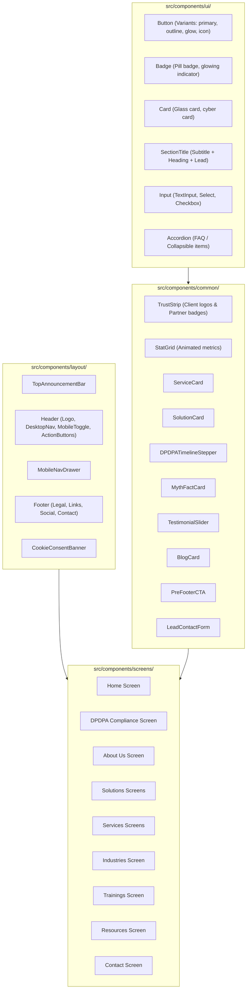
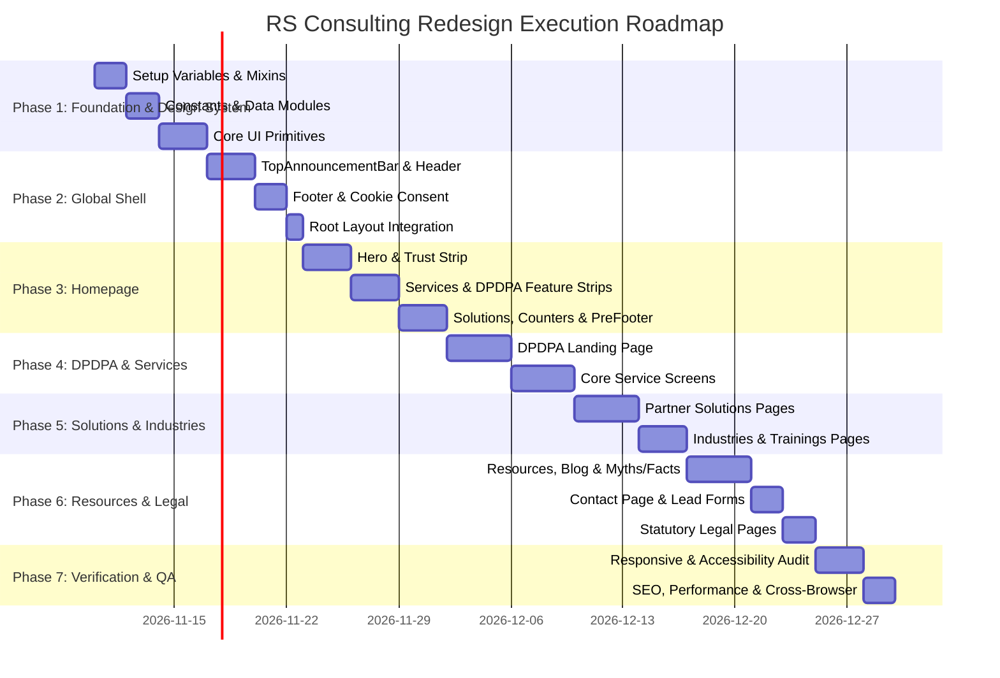

# RS Consulting Website Redesign — Master Technical Development Plan
**Version:** 1.0.0  
**Date:** November 2026  
**Target Template Reference:** CyberGuard Home 05 (`https://demo.bravisthemes.com/cyberguard/home-05/`)  
**Current Website:** `https://www.rsctec.com/`  
**Core Content Document:** `RSConsulting_Website_DPDPA_Content_Pack.docx` (Version 2)  
**Architectural Standard:** Next.js 16 (App Router), Vanilla JavaScript (ES6+), SCSS Modules, Strict Compliance with `rules.md`

---

## Executive Summary
This document provides the definitive, comprehensive architecture and execution plan for transforming RS Consulting's digital web presence into an elite, cybersecurity-focused corporate platform. The redesign merges the visual design language of **CyberGuard Home 05** (high-contrast deep navy/slate backgrounds, glowing cyan/blue accents, modern glassmorphism badges, crisp typography, and dynamic interactive cards) with RS Consulting's verified brand identity, legacy credentials (4+ decades of collective IT security leadership), enterprise client experience (BFSI, fintech, SaaS), partner technology integrations (Qualys, OpenText, SearchInform, Securely Share, Morphisec), and the updated **DPDPA (Digital Personal Data Protection Act, 2023 / Rules 2025)** compliance service suite leading up to the **13 May 2027** enforcement deadline.

---

## 1. Existing Project Analysis

### 1.1 Tech Stack & Environment
- **Framework:** Next.js 16.2.10 (React 19.2.4, React DOM 19.2.4) using the App Router.
- **Language:** JavaScript (`.js` files; strict rule against TypeScript).
- **Styling Architecture:** Pure SCSS Modules (`sass: ^1.101.0`). No Tailwind CSS, No Styled Components, No CSS-in-JS.
- **Global Preprocessing:** `next.config.mjs` configures `sassOptions.additionalData` to globally inject:
  - `@use "@/styles/scss/variables" as *;`
  - `@use "@/styles/scss/mixins" as *;`
  - `@use "@/styles/scss/media_queries" as *;`
  *Rule Enforcement:* Individual SCSS modules must never manually include `@use "@/styles/scss/..."`.
- **Linting & Compilation:** ESLint 9 (`eslint-config-next: 16.2.10`), `babel-plugin-react-compiler: 1.0.0`.

### 1.2 Existing Codebase State
- `src/app/layout.js`: Basic root layout importing `globals.scss`, `Header`, `Footer`, and `FONTS`.
- `src/app/page.js`: Minimal wrapper importing the screen component `Home`.
- `src/components/layout/`: Contains initial `Header` (`Header.jsx`) and `Footer` (`Footer.jsx`). *Audit note:* File extensions must be standardized to `.js` per `rules.md`.
- `src/components/screens/Home/`: Skeleton home screen divided into `sections/Hero`, `sections/Features`, and `components/FeatureCard`.
- `src/components/ui/`: Contains placeholder folders `custom_button` and `custom_container`. Needs reorganization to match PascalCase conventions (`Button/Button.js`, `Container/Container.js`).
- `src/constants/constants.js`: Currently empty (0 bytes). Needs population with navigation, partner data, DPDPA copy, services, blog posts, and legal metadata.
- `src/context/AppContext.js`: Currently empty (0 bytes). Ready for global UI state (mobile drawer toggle, cookie consent state, assessment modal).
- `src/styles/`:
  - `fonts.js`: Configured with Google Fonts `Poppins` (Font 1) and `Oxanium` (Font 2).
  - `globals.scss`: Defines base reset, CSS custom properties, dark-mode overrides, and `.container`.
  - `scss/_variables.scss`: Base color palette, spacing, font sizes, shadows, transitions.
  - `scss/_mixins.scss`: Flexbox and default box mixins.
  - `scss/_media_queries.scss`: Breakpoint map (`xs: 0`, `sm: 576px`, `md: 768px`, `lg: 992px`, `xl: 1200px`, `xxl: 1400px`) and responsive mixins (`respond-above`, `respond-below`, `respond-between`).

### 1.3 Strict Architectural Constraints
1. **Screen Component Isolation:** Page routes (`src/app/**/page.js`) must strictly contain no UI markup—only importing and rendering its corresponding screen component from `src/components/screens/`.
2. **File & Component Sizing:** Every component must have its own isolated folder, `.js` component file, and `.module.scss` file. No component file may exceed 200 lines. Components exceeding 200 lines must be split into sub-components.
3. **Styling Rules:** All styles must come from SCSS modules using defined variables and mixins. No hardcoded hex values, no inline CSS styles, and no manual `@media` queries outside the breakpoint mixins.

---

## 2. Current Website Audit (`rsctec.com`)

### 2.1 Corporate Identity & Legal Entities
- **Trading Brand:** RS Consulting (used across marketing, headlines, and client materials).
- **Legal Entity:** RSC Techasist Private Limited (CIN: `U62020TN2024PTC171029`).
- **Registered Address:** Flat A2, No. 50, 1st Floor, Venkatesa Perumal 2nd Street, Iyappa Nagar, Madipakkam, Chennai – 600091, Tamil Nadu.
- **Official Contact Details:**
  - Phone: `+91 97910 21099`
  - WhatsApp: Direct click-to-chat to `+91 97910 21099`
  - General & Compliance Email: `konnect@rsctec.com`
- **Core Brand Tagline:** *"Delivering ingenious perspective to your information security"*.

### 2.2 Existing Content Inventory
- **About:** Founded originally in 2015, operating under collective team leadership with over 4 decades of experience in cybersecurity and enterprise IT.
- **Cultural Pillars:** Team ("People are our business"), Quality ("Quality is integral to everything we do"), Integrity ("We work with the highest of integrity").
- **Core Technology Solutions:**
  1. *Qualys:* Cloud platform for continuous vulnerability management, VMDR, patch management, and configuration auditing.
  2. *CyberRes-Micro Focus (now OpenText Cybersecurity):* Enterprise cyber resilience, data discovery, classification, and protection.
  3. *Securely Share:* Patented data security (7 US patents) for privacy-enabled secure data sharing, access control, and PII automation.
  4. *SearchInform:* Risk Monitor for DLP (Data Loss Prevention), internal auditing, and user activity monitoring.
  5. *Morphisec (from Content Pack):* Moving Target Defense (MTD) advanced endpoint prevention against zero-day and memory exploits.
- **Trainings Catalog:** 16 specialized industry training programs including CDPO (Certified Data Protection Officer), CAIO (Chief AI Officer), CISRO, CSPT, CISO, and ISO 27001:2022 / ISO 27701 Lead Auditor programs.

### 2.3 Identified Deficiencies of Current Site
- Outdated, generic template layout with poor visual hierarchy and lack of cyber-tech aesthetics.
- Absence of dedicated pages for core service practices (Cyber Risk, DPDPA Compliance, Cloud Security).
- Missing responsive navigation drawer and sticky submenus.
- Privacy policy lacks DPDPA statutory disclosures (no Grievance Officer details, no retention schedule, no Data Protection Board complaint mechanisms).
- Forms do not comply with DPDPA consent requirements (no separate optional marketing opt-in or plain-language data fiduciary notice).

---

## 3. Target Template Design Analysis (CyberGuard Home 05)

### 3.1 Visual Language & Aesthetic DNA
CyberGuard Home 05 presents an authoritative, high-tech cybersecurity aesthetic characterized by:
- **Atmospheric Palette:** Dark, futuristic theme with deep obsidian/navy backgrounds (`#0a0e1a`, `#0f172a`, `#131b2e`), electric blue/indigo primary accents (`#3b82f6`, `#4a81d3`), vivid cyan highlights (`#06b6d4`, `#00f2fe`), and crisp silver/white typography.
- **Header Structure:**
  - *Top Announcement & Contact Bar:* Micro-information displaying physical address, direct phone, email, and social links with subtle hover transitions.
  - *Sticky Main Navigation:* Glassmorphic translucent backdrop with logo on the left, centered navigation with interactive drop indicators, and dual high-visibility CTA buttons on the right ("Book Assessment", "WhatsApp Us").
- **Hero Architecture:**
  - Micro-eyebrow pill with glowing status dot (e.g., "Officially Certified" -> adapts to "DPDP Act, 2023 · Compliance Mandatory by 13 May 2027").
  - Bold, impactful H1 typography with gradient text highlights.
  - Dual action button group (Glow Primary + Outline Secondary).
  - Horizontal feature capsule strip below the hero copy showcasing core capabilities with mini-icons.
- **Interactive Component Patterns:**
  - *Stat Counters:* Floating cards showing metrics with illuminated borders.
  - *Service & Solution Cards:* Dark elevated cards with subtle border gradients (`rgba(255,255,255,0.08)`), glowing icon boxes, clear value copy, and animated arrow links.
  - *Split Value Rows:* Two-column asymmetric layouts pairing high-resolution imagery/diagrams with structured feature lists and checkmarks.
  - *Trust Strips & Client Marquees:* Clean grayscale/monochrome client and partner logo displays that illuminate on hover.
  - *Pre-Footer Banner:* High-contrast call-to-action block driving user conversions before reaching the structured 4-column footer.

---

## 4. Content Document Analysis (`RSConsulting_Website_DPDPA_Content_Pack`)

### 4.1 Strategic Positioning
RS Consulting delivers **Security-Led DPDPA Compliance**. Unlike generic legal or paper-only consultancies, RS Consulting bridges statutory legal obligations directly to technological safeguards implemented through proven global partner platforms (Qualys, OpenText, SearchInform, Securely Share, Morphisec).

### 4.2 Key Regulatory Milestones to Spotlight
1. **13 November 2025:** DPDP Rules notified; Data Protection Board of India (DPBI) operationalized.
2. **13 November 2026:** Consent Manager framework live; systems must support digital consent interoperability.
3. **13 May 2027:** Full enforcement of core obligations (notices, verifiable parental consent, security safeguards, breach reporting). Penalties up to **₹250 crore** per instance.

### 4.3 DPDPA Technology Mapping Matrix
| DPDPA Statutory Obligation | Technological Safeguard | Partner Solution |
| :--- | :--- | :--- |
| **Reasonable Security Safeguards** | Continuous vulnerability management, patch automation, configuration compliance | **Qualys VMDR** |
| **Data Discovery & Classification** | PII discovery across structured & unstructured data stores | **OpenText Cybersecurity** |
| **Data Leak Prevention & Insider Threat** | DLP, file auditing, and user activity monitoring | **SearchInform Risk Monitor** |
| **Secure Third-Party Data Transfer** | Patented encrypted data exchange with granular access logs | **Securely Share** |
| **Endpoint Breach Prevention** | Moving Target Defense against zero-day and memory exploits | **Morphisec** |
| **Breach Incident Response & Reporting** | Real-time monitoring paired with 6-hr CERT-In & DPBI response playbooks | **Qualys + RS Consulting Services** |

### 4.4 Engagement Tiers
- **DPDPA Starter:** Targeted at startups & SMEs. Includes personal data inventory, consent notice overhaul, core governance policies, and initial team training.
- **DPDPA Comprehensive:** Targeted at mid-market and enterprise organizations. Full gap assessment, security safeguards deployment, vendor processing agreements, breach simulation tabletop exercises.
- **DPDPA Assure:** Ongoing advisory, quarterly audits, control monitoring, Data Principal rights workflow support, and DPBI regulatory change management.

---

## 5. Website Architecture & Complete Sitemap

```mermaid
graph TD
    Root["RS Consulting (rsctec.com)"]
    Root --> Home["Home (/)"]
    Root --> About["About Us (/about)"]
    
    Root --> Services["Services (/services)"]
    Services --> Serv_Risk["Cyber Risk & Security (/services/cyber-risk-security)"]
    Services --> Serv_DPDPA["Data Privacy & DPDPA Compliance (/dpdpa-compliance)"]
    Services --> Serv_Cloud["Cloud Security (/services/cloud-security)"]
    Services --> Serv_MSS["Managed Security Services (/services/managed-security)"]
    
    Root --> Solutions["Solutions (/solutions)"]
    Solutions --> Sol_Qualys["Qualys (/solutions/qualys)"]
    Solutions --> Sol_OpenText["OpenText (/solutions/opentext)"]
    Solutions --> Sol_SearchInform["SearchInform (/solutions/searchinform)"]
    Solutions --> Sol_SecurelyShare["Securely Share (/solutions/securely-share)"]
    Solutions --> Sol_Morphisec["Morphisec (/solutions/morphisec)"]
    
    Root --> Industries["Industries (/industries)"]
    Root --> Trainings["Trainings & Certifications (/trainings-certifications)"]
    
    Root --> Resources["Resources (/resources)"]
    Resources --> Res_Checklist["25-Point DPDPA Checklist (/resources/dpdpa-checklist)"]
    Resources --> Res_MythFact["Myth vs Fact Series (/resources/myths-vs-facts)"]
    Resources --> Res_Blog["Insights / Blog (/blog)"]
    
    Root --> Contact["Contact Us (/contact)"]
    Root --> Legal["Legal & Governance"]
    Legal --> Leg_Privacy["Privacy Policy (/privacy-policy)"]
    Legal --> Leg_Terms["Terms of Use (/terms-of-use)"]
    Legal --> Leg_Grievance["Grievance Officer (/grievance-officer)"]
```



---

## 6. Page-by-Page Detailed Section Breakdown

### 6.1 Home Page (`/`)
- **Route:** `src/app/page.js` -> `src/components/screens/Home/Home.js`
- **Purpose:** Primary digital storefront; establishes cybersecurity authority, introduces DPDPA urgency, displays partner solutions, client trust, and directs conversions.
- **Target Audience:** CISOs, CIOs, Data Protection Officers, Managing Directors, IT Directors across BFSI, SaaS, Healthcare, and Enterprise sectors.
- **Section Breakdown:**
  1. *Top Announcement Bar:* DPDPA deadline countdown alert (13 May 2027) with direct audit link.
  2. *Header Navigation:* Multi-tiered sticky navigation with dropdown menus and dual CTA.
  3. *Hero Section:*
     - Dual-slide dynamic banner:
       - Slide 1 (Cybersecurity): "Delivering ingenious perspective to your information security".
       - Slide 2 (DPDPA): "Delivering ingenious perspective to your data protection · DPDP Act, 2023 Compliance".
     - Primary CTAs: "Book Free Assessment" + "Explore Services".
     - Capsule Badges: Network Security, Data Encryption, Identity & Access, Security Monitoring, Endpoint Protection, Cloud Defense.
  4. *Trust & Partner Strip:* Monochrome logos of global partners (Qualys, OpenText, SearchInform, Securely Share, Morphisec) and BFSI/Fintech client credentials.
  5. *About RS Consulting Spotlight:* Asymmetric split layout with experience badge (4+ Decades Collective Leadership), core values, and security philosophy.
  6. *Core Services Grid:* 4 primary cards (Cyber Risk, DPDPA Compliance, Cloud Security, Managed Security) in CyberGuard Home 05 card style.
  7. *DPDPA Compliance High-Impact Feature:* Milestone timeline (2025 -> 2026 -> 2027), risk exposure metrics (₹250 Cr penalties), and technology-led approach.
  8. *Partner Technology Showcase:* Interactive tabbed showcase mapping the 5 solutions to cyber resiliency and data governance.
  9. *Key Statistics Bar:* 4 counter modules (Decades of Experience, Partner Solutions, Enterprise Audits, Regulatory Deadlines).
  10. *Industry Coverage Matrix:* Quick-navigation grid covering BFSI, Fintech, Healthcare, SaaS, Retail, Manufacturing.
  11. *Client Testimonials / Case Highlights:* Verified feedback cards with ratings and impact metrics.
  12. *Latest Insights & Blogs:* 3-column thought-leadership previews with category badges and read times.
  13. *Pre-Footer High-Impact Banner:* "The deadline won't move. Your compliance can." with direct appointment booking and WhatsApp CTA.
  14. *Main Corporate Footer:* Legal entity details, quick links, practice directories, contact information.

### 6.2 Data Privacy & DPDPA Compliance Page (`/dpdpa-compliance`)
- **Route:** `src/app/dpdpa-compliance/page.js` -> `src/components/screens/DPDPACompliance/DPDPACompliance.js`
- **Purpose:** High-converting landing page for DPDPA campaigns, ads, QR codes, and enterprise assessments.
- **Target Audience:** Legal Counsel, Compliance Officers, Data Protection Officers, Risk Committees, Founders.
- **Section Breakdown:**
  1. *Hero Banner:* "Get DPDPA-Ready Before 13 May 2027" · Subheading on security-led compliance · CTAs: "Book Free Assessment", "Download 25-Point Checklist".
  2. *Why It Matters Now (Timeline & Regulatory Milestones):* Table and interactive visual stepper for Nov 2025, Nov 2026, May 2027 with penalty risks.
  3. *Common Organizational Gaps:* 5 critical blindspots (unmapped PII, invalid consent, unverified breach response, vendor contracts, endpoint logging).
  4. *Myth vs Fact Spotlight:* High-visibility card highlighting Myth 1 ("DPDP applies only to tech companies") with link to full series.
  5. *Core DPDPA Service Offerings:* 9-card breakdown (Readiness Assessment, Notice & Consent, Security Safeguards Implementation, Breach Playbooks, Data Principal Rights Workflows, Vendor Governance, Governance Policies, Employee Training, Ongoing Assure Support).
  6. *Technology Mapping Matrix:* Interactive table showing Qualys, OpenText, SearchInform, Securely Share, Morphisec solving statutory obligations.
  7. *Our Methodology (6-Step Lifecycle):* Discover -> Assess -> Plan -> Implement -> Train -> Sustain.
  8. *Sector Priorities Guide:* Tailored compliance requirements for BFSI, IT/ITES, Healthcare, EdTech, Retail, Manufacturing, Real Estate.
  9. *Engagement Packages Comparison:* 3-tier matrix comparing DPDPA Starter, Comprehensive, and Assure.
  10. *Frequently Asked Questions:* Accordion addressing applicability, penalties, ISO 27001 overlap, CERT-In integration, and assessment turnaround.
  11. *Lead Generation Form:* DPDPA-compliant intake form with statutory consent notice.

### 6.3 About Us Page (`/about`)
- **Route:** `src/app/about/page.js` -> `src/components/screens/About/About.js`
- **Purpose:** Establish brand authority, company history, leadership vision, and engineering culture.
- **Section Breakdown:**
  1. *Hero Banner:* "Pioneering Ingenious Perspectives in Cybersecurity & Cyber Risk".
  2. *Our Story & Foundation:* Narrative bridging 2015 origins to current corporate structure (RSC Techasist Pvt Ltd).
  3. *Core Cultural Values:* Team, Quality, Integrity with dedicated iconography.
  4. *Leadership & 4-Decade Collective Heritage:* Expertise breakdown across enterprise banking, telecommunications, and defense-grade security.
  5. *Global Technology Ecosystem:* Overview of strategic partner relationships.
  6. *Quality Standards & Certification Status:* Clear, verified disclosures regarding quality management frameworks.
  7. *CTA Section:* Connect with senior security leadership.

### 6.4 Services Hub & Individual Service Pages
- **Routes:**
  - `/services` (Overview Hub)
  - `/services/cyber-risk-security` (VAPT, Red Teaming, Cyber Risk Assessment)
  - `/services/cloud-security` (Cloud Architecture Security, CSPM, CWPP)
  - `/services/managed-security` (SOC Advisory, Incident Response, MSSP Support)
- **Section Breakdown (per page):**
  1. *Hero:* Specific service value proposition with instant assessment CTA.
  2. *Problem Statement & Threat Landscape:* Real-world attack vectors and business risks.
  3. *Core Capabilities & Deliverables:* Modular grid of technical interventions.
  4. *Partner Technology Integration:* How tools like Qualys or OpenText power the service.
  5. *Standard Operating Procedure / Process:* Phase-by-phase execution model.
  6. *Industry Use Cases:* Specific vertical implementation examples.
  7. *Related Services & Case Studies:* Cross-linking to DPDPA and Cloud Security.
  8. *Contact & Scoping Form:* Focused consultation booking module.

### 6.5 Solutions Hub & Individual Partner Pages
- **Routes:**
  - `/solutions` (Overview Hub)
  - `/solutions/qualys` (Vulnerability Management, VMDR, Patching)
  - `/solutions/opentext` (Data Discovery, Classification, Governance)
  - `/solutions/searchinform` (Risk Monitor, DLP, Insider Threat Prevention)
  - `/solutions/securely-share` (Patented Encrypted File Sharing, Access Governance)
  - `/solutions/morphisec` (Moving Target Defense, Zero-Day Endpoint Defense)
- **Section Breakdown (per page):**
  1. *Hero Section:* Product positioning, partner badge, architecture diagram placeholder.
  2. *Solution Overview & Architecture:* Deep dive into how the technology protects enterprise assets.
  3. *How It Supports DPDPA Compliance:* Dedicated statutory alignment box.
  4. *Key Features & Capabilities:* 6-8 highlighted platform modules.
  5. *RS Consulting Implementation Advantage:* Deployment, policy tuning, 24/7 support.
  6. *Request a Demo / POC Banner:* Dedicated lead capture for proof-of-concept requests.

### 6.6 Industries Page (`/industries`)
- **Route:** `src/app/industries/page.js` -> `src/components/screens/Industries/Industries.js`
- **Purpose:** Demonstrate domain-specific threat expertise and compliance nuance.
- **Sectors Covered:** BFSI & Fintech, IT/ITES & SaaS, Healthcare & Life Sciences, Education & EdTech, Retail & E-Commerce, Manufacturing & Logistics, Real Estate & Hospitality, Government & PSUs.
- **Sections:** Industry selector tab bar, Sector risk profile, Regulatory demands, Tailored RS Consulting solution stack, Case references.

### 6.7 Trainings & Certifications Page (`/trainings-certifications`)
- **Route:** `src/app/trainings-certifications/page.js` -> `src/components/screens/Trainings/Trainings.js`
- **Purpose:** Promote corporate training workshops and industry accreditation tracks.
- **Section Breakdown:**
  1. *Hero:* "Empowering Workforce Resiliency & Certified Cyber Competence".
  2. *Featured DPDPA Courses:*
     - DPDPA Awareness for Employees (1-2 Hours)
     - DPDPA for Leadership & CXOs (2 Hours)
     - DPDPA Certified Practitioner (1-2 Days)
  3. *Executive & Officer Track:* Certified Data Protection Officer (CDPO), Chief AI Security Officer (CAIO), CISRO, CISO.
  4. *Technical Defense Track:* Penetration Tester (CSPT), DevSecOps Professional, Cloud Security Officer (CCSGO).
  5. *ISO Lead Auditor Track:* ISO 27001:2022, ISO 27701, ISO 42001 (AI Governance).
  6. *Corporate Enrollment Inquiry Form:* Group booking and tailored syllabus request.

### 6.8 Resources & Blog Hub
- **Routes:**
  - `/resources` (Resource Library)
  - `/resources/dpdpa-checklist` (Lead Magnet Download Landing Page)
  - `/resources/myths-vs-facts` (Interactive 6-part DPDPA debunking series)
  - `/blog` (Insights Hub)
  - `/blog/[slug]` (Individual Article Screen)
- **Features:** 25-Point Checklist download modal, interactive 5-question quick self-check assessment, filtered blog categories (DPDPA, Cyber Risk, Cloud, Compliance).

### 6.9 Contact Us Page (`/contact`)
- **Route:** `src/app/contact/page.js` -> `src/components/screens/Contact/Contact.js`
- **Purpose:** Multi-channel inquiry capture and regional office contact.
- **Section Breakdown:**
  1. *Hero:* "Let's Discuss Your Security & Compliance Posture".
  2. *Direct Channel Grid:* Phone, Email, WhatsApp, Physical Address cards with interactive click-to-contact triggers.
  3. *DPDPA-Compliant Lead Form:*
     - Name, Business Email, Phone, Company, Industry Dropdown, Service Interest, Message.
     - Plain-language DPDPA statutory notice.
     - Mandatory enquiry consent checkbox.
     - Unchecked optional marketing newsletter consent checkbox.
  4. *Interactive Location Map Placeholder:* Madipakkam, Chennai headquarters.

### 6.10 Statutory Legal Pages
- `/privacy-policy`: Full DPDPA-aligned policy detailing data fiduciary identity, categories of data processed, retention periods (12 months for inquiries), Data Principal rights (access, correction, erasure), Grievance Officer details, and DPBI escalation rights.
- `/terms-of-use`: Standard corporate digital terms of service.
- `/grievance-officer`: Dedicated transparency page listing the designated Grievance Officer contact, turnaround SLA (30 days), and escalation procedure.

---

## 7. UI/UX Design System Specification (CyberGuard Adaptation)

### 7.1 SCSS Variable Architecture (`src/styles/scss/_variables.scss`)
To reproduce the visual language of CyberGuard Home 05 while honoring RS Consulting's corporate identity, the variables file must be expanded to include:

```scss
// ==========================================
// RS CONSULTING DESIGN SYSTEM VARIABLES
// Exact Color Codes from CyberGuard Home 05 (post-19.css & pxl-style-inline-css)
// ==========================================

// Core Brand & Accent Colors (Exact CyberGuard Home 05 Palette)
$primary: #4a81d3;               // Exact CyberGuard Primary Blue (74, 129, 211)
$primary-hover: #3b6eb8;         // Darker Blue on Hover
$primary-rgb: 74, 129, 211;

$secondary: #514a9d;             // Exact CyberGuard Indigo / Purple Gradient Target (81, 74, 157)
$secondary-hover: #433d85;

// CyberGuard Gradients
$primary-gradient: linear-gradient(45deg, #4a81d3 0%, #514a9d 100%);
$hero-gradient-overlay: linear-gradient(0deg, rgba(18, 19, 44, 0.75) 0%, rgba(18, 19, 44, 0.75) 50%);
$hero-fade-gradient: linear-gradient(0deg, #12132c 0%, rgba(18, 19, 44, 0) 100%);

// Dark Backgrounds & Atmospheric Surfaces (Exact CyberGuard Home 05)
$background-dark: #12132c;       // Exact Home 05 Hero, Services & Project BG (18, 19, 44)
$surface-dark-elevated: #191b36; // Exact Home 05 "Why Choose Us" BG (25, 27, 54)
$surface-dark-highlight: #222e66;// Exact Home 05 Ticker / Mid-banner BG (34, 46, 102)

// Light Backgrounds & Crisp Contrast (Exact Home 05 Alternating Sections)
$background-light: #f3f3f4;      // Exact Home 05 Testimonial & About Light BG (243, 243, 244)
$background: #ffffff;            // Pure White
$foreground: #111013;            // Exact CyberGuard Dark Link & Text Color (17, 16, 19)

// Typography Colors
$text-light: #ffffff;            // Crisp White Headings on Dark (#ffffff)
$text-light-muted: rgba(255, 255, 255, 0.75); // Subtitle / body on dark (#ffffffbf)
$text-secondary: #797a8c;        // Exact CyberGuard Muted Secondary Gray (121, 122, 140)
$text-muted: #797a8c;

// Accent & Status Colors
$accent: #fec42c;                // Exact CyberGuard Gold / Star Rating Accent (#fec42c)
$accent-cyan: #00f2fe;           // High-tech status indicator
$border-light: rgba(255, 255, 255, 0.15); // Glass borders (#ffffff80 on buttons)
$border-muted: #dee2e6;          // Exact Light Section Border (#dee2e6)

// Spacing System
$space-xs: 0.25rem;   // 4px
$space-sm: 0.5rem;    // 8px
$space-md: 1rem;      // 16px
$space-lg: 1.5rem;    // 24px
$space-xl: 2rem;      // 32px
$space-xxl: 3rem;     // 48px
$space-xxxl: 5rem;    // 80px
$space-huge: 6.25rem; // 100px (padding-top/bottom in Home 05 sections)

// Typography Hierarchy
$font-family-base: var(--font-primary), sans-serif; // Poppins
$font-family-display: var(--font-primary), sans-serif; // Oxanium / Urbanist

$text-xs: 0.75rem;    // 12px
$text-sm: 0.875rem;   // 14px (Home 05 eyebrow subtitles)
$text-base: 1rem;     // 16px
$text-lg: 1.125rem;   // 18px (Home 05 feature pills)
$text-xl: 1.1875rem;  // 19px (Home 05 lead sub-titles)
$text-2xl: 1.5rem;    // 24px
$text-3xl: 2rem;      // 32px (Home 05 section subtitles)
$text-4xl: 3rem;      // 48px (Home 05 section H2 titles)
$text-5xl: 4rem;      // 64px (Home 05 hero H1 title)

// Border Radii
$radius-sm: 4px;
$radius-md: 8px;
$radius-lg: 10px;     // Exact Home 05 Card Radius (border-radius: 10px)
$radius-xl: 16px;
$radius-full: 9999px; // Pill shape

// Shadows
$shadow-sm: 0 2px 4px rgba(0, 0, 0, 0.08);
$shadow-md: 0 4px 12px rgba(0, 0, 0, 0.12);
$shadow-card: 0px 10px 30px 0px rgba(30, 30, 30, 0.3); // Exact Home 05 box-shadow
$shadow-glow-primary: 0 0 25px rgba(74, 129, 211, 0.4);

// Transitions
$transition-fast: 150ms cubic-bezier(0.4, 0, 0.2, 1);
$transition-default: 300ms cubic-bezier(0.4, 0, 0.2, 1);
$transition-smooth: 500ms cubic-bezier(0.4, 0, 0.2, 1);
```

### 7.2 SCSS Mixins (`src/styles/scss/_mixins.scss`)
```scss
@mixin flexCenter {
  display: flex;
  justify-content: center;
  align-items: center;
}

@mixin flexBetween {
  display: flex;
  justify-content: space-between;
  align-items: center;
}

@mixin glassmorphism {
  background: rgba(17, 24, 44, 0.7);
  backdrop-filter: blur(16px);
  -webkit-backdrop-filter: blur(16px);
  border: 1px solid $border-light;
}

@mixin cyberCard {
  background: $card-gradient;
  border: 1px solid $border-light;
  border-radius: $radius-lg;
  padding: $space-xl;
  transition: transform $transition-default, border-color $transition-default, box-shadow $transition-default;
  
  &:hover {
    transform: translateY(-6px);
    border-color: $border-accent;
    box-shadow: $shadow-glow-cyan;
  }
}
```

### 7.3 Responsive Breakpoint Implementation
Strict enforcement of `_media_queries.scss`:
- Mobile devices: `@include respond-below(md) { ... }`
- Tablets: `@include respond-between(md, lg) { ... }`
- Standard Desktop: `@include respond-above(lg) { ... }`
- Wide Desktop: `@include respond-above(xl) { ... }`
*Zero tolerance for hardcoded `@media (min-width: ...)` rules in any SCSS file.*

---

## 8. Component Architecture & Modular Hierarchy

Every component adheres strictly to the rule:
1. `ComponentName.js`
2. `ComponentName.module.scss`
3. Single component per file, maximum 200 lines.



---

## 9. Proposed Project Folder Structure

```
rsctec/
├── public/
│   ├── images/
│   │   ├── hero/                  # Cyber visuals, network shields, security hero backgrounds
│   │   ├── partners/              # Qualys, OpenText, SearchInform, SecurelyShare, Morphisec logos
│   │   ├── clients/               # Banking, Fintech, SaaS client logos (HDFC, PayU, Mindtree, etc.)
│   │   ├── services/              # High-tech isometric icons for VAPT, Cloud, DPDPA, MSSP
│   │   ├── team/                  # Executive and advisor profile pictures
│   │   └── blog/                  # High-resolution featured post thumbnails
│   ├── icons/                     # Inline SVG icon sprites / cyber icons
│   └── documents/                 # DPDPA_Readiness_Checklist_RS_Consulting.pdf
│
├── src/
│   ├── app/
│   │   ├── layout.js              # Root layout with fonts, Header, Footer, CookieBanner
│   │   ├── page.js                # Imports Home screen component
│   │   ├── about/page.js          # Imports About screen component
│   │   ├── dpdpa-compliance/page.js # Imports DPDPA Compliance screen component
│   │   ├── services/
│   │   │   ├── page.js            # Services Hub
│   │   │   ├── cyber-risk-security/page.js
│   │   │   ├── cloud-security/page.js
│   │   │   └── managed-security/page.js
│   │   ├── solutions/
│   │   │   ├── page.js            # Solutions Hub
│   │   │   ├── qualys/page.js
│   │   │   ├── opentext/page.js
│   │   │   ├── searchinform/page.js
│   │   │   ├── securely-share/page.js
│   │   │   └── morphisec/page.js
│   │   ├── industries/page.js     # Industries Hub
│   │   ├── trainings-certifications/page.js # Trainings & certifications catalog
│   │   ├── resources/
│   │   │   ├── page.js            # Resources Hub
│   │   │   ├── dpdpa-checklist/page.js
│   │   │   └── myths-vs-facts/page.js
│   │   ├── blog/
│   │   │   ├── page.js            # Blog Listing
│   │   │   └── [slug]/page.js     # Blog Detail
│   │   ├── contact/page.js        # Contact Us Screen
│   │   ├── privacy-policy/page.js # DPDPA Privacy Policy
│   │   ├── terms-of-use/page.js   # Terms of Service
│   │   └── grievance-officer/page.js # Statutory Grievance Redressal
│   │
│   ├── components/
│   │   ├── common/
│   │   │   ├── BlogCard/
│   │   │   ├── ContactForm/
│   │   │   ├── DPDPAOverview/
│   │   │   ├── MythFactCard/
│   │   │   ├── PreFooterCTA/
│   │   │   ├── ServiceCard/
│   │   │   ├── SolutionCard/
│   │   │   ├── StatGrid/
│   │   │   ├── TestimonialCard/
│   │   │   ├── TimelineStepper/
│   │   │   └── TrustStrip/
│   │   │
│   │   ├── layout/
│   │   │   ├── CookieBanner/
│   │   │   ├── Footer/
│   │   │   ├── Header/
│   │   │   ├── MobileNav/
│   │   │   └── TopAnnouncementBar/
│   │   │
│   │   ├── screens/
│   │   │   ├── About/
│   │   │   ├── Blog/
│   │   │   ├── BlogDetail/
│   │   │   ├── Contact/
│   │   │   ├── DPDPACompliance/
│   │   │   ├── Grievance/
│   │   │   ├── Home/
│   │   │   ├── Industries/
│   │   │   ├── PrivacyPolicy/
│   │   │   ├── Resources/
│   │   │   ├── Services/
│   │   │   ├── Solutions/
│   │   │   ├── Terms/
│   │   │   └── Trainings/
│   │   │
│   │   └── ui/
│   │       ├── Accordion/
│   │       ├── Badge/
│   │       ├── Button/
│   │       ├── Card/
│   │       ├── Container/
│   │       ├── Input/
│   │       ├── Modal/
│   │       ├── SectionTitle/
│   │       └── Tabs/
│   │
│   ├── constants/
│   │   ├── constants.js           # Re-exports or primary index
│   │   ├── navigation.js          # Header menus, footer links, dropdown maps
│   │   ├── dpdpaData.js           # Milestones, myths, tech mapping, faqs
│   │   ├── servicesData.js        # Service descriptions and capabilities
│   │   ├── solutionsData.js       # Partner technologies (Qualys, OpenText, etc.)
│   │   ├── industriesData.js      # Sector guides and compliance demands
│   │   ├── trainingsData.js       # Full 16-course accreditation catalog
│   │   ├── blogsData.js           # Articles and thought leadership posts
│   │   └── companyData.js         # Legal entities, contact info, offices
│   │
│   ├── context/
│   │   └── AppContext.js          # Client context: mobile drawer, active modals, cookies
│   │
│   └── styles/
│       ├── fonts.js               # Poppins and Oxanium font definitions
│       ├── globals.scss           # Base resets, container, global body background
│       └── scss/
│           ├── _variables.scss    # Global colors, typography, shadows, spacing
│           ├── _mixins.scss       # Flexbox, glassmorphism, card styling helpers
│           └── _media_queries.scss # Standard responsive mixins
│
├── next.config.mjs
├── package.json
├── rules.md
├── DEVELOPMENT_PLAN.md
└── PROJECT_STRUCTURE.md
```

---

## 10. Development Roadmap & Phased Execution Plan



### Phase 1: Foundation, Design System & Data Layer
- **Objectives:** Align styling configurations with CyberGuard aesthetics and extract all structured data into `src/constants/`.
- **Tasks:**
  1. Update `src/styles/scss/_variables.scss` to incorporate the cyber navy, glowing cyan, and deep background tokens without breaking existing references.
  2. Enhance `src/styles/scss/_mixins.scss` with glassmorphism and card elevation helpers.
  3. Create individual constant modules inside `src/constants/`:
     - `navigation.js`, `dpdpaData.js`, `servicesData.js`, `solutionsData.js`, `trainingsData.js`, `industriesData.js`, `companyData.js`.
  4. Develop basic UI primitive components under `src/components/ui/`:
     - `Button/Button.js`, `Container/Container.js`, `Badge/Badge.js`, `SectionTitle/SectionTitle.js`, `Card/Card.js`.
- **Completion Criteria:** SCSS variables compile cleanly without warnings; UI primitives render as expected in isolation.

### Phase 2: Global Shell, Navigation & Layout
- **Objectives:** Construct the header, mobile drawer, footer, and statutory cookie banner.
- **Tasks:**
  1. Build `TopAnnouncementBar` displaying the May 2027 countdown, phone, email, and social icons.
  2. Implement `Header` with sticky scrolling behavior, glassmorphic backdrop, dropdown indicators, and dual action buttons.
  3. Create `MobileNav` drawer with accordion menus and tap-friendly touch targets.
  4. Build 4-column rich `Footer` containing legal corporate disclosures (CIN, Registered Office, WhatsApp trigger).
  5. Build `CookieBanner` with 3 statutory options (Accept essential only, Accept all, Manage preferences).
  6. Connect components in `src/app/layout.js`.
- **Completion Criteria:** Navigation operates seamlessly on mobile and desktop viewports; sticky headers transition smoothly without layout shifting.

### Phase 3: Homepage Redesign (CyberGuard Home 05 Adaptation)
- **Objectives:** Assemble the flagship homepage showcasing RS Consulting's cyber authority and DPDPA leadership.
- **Tasks:**
  1. `Hero` section with dual-slide logic, pill badge, glowing CTA buttons, and feature capsule strip.
  2. `TrustStrip` with grayscale-to-color hover effects for global partners and client logos.
  3. `AboutSpotlight` highlighting the 4+ decade collective legacy and quality principles.
  4. `ServicesOverview` rendering 4 interactive cards with glowing hover states.
  5. `DPDPAUrgencyStrip` highlighting statutory milestones (2025, 2026, 2027) and ₹250 Cr penalties.
  6. `SolutionShowcase` featuring Qualys, OpenText, SearchInform, Securely Share, and Morphisec.
  7. `StatGrid` counter modules.
  8. `TestimonialSlider` & `BlogGrid` previews.
  9. `PreFooterCTA` banner driving consultation requests.
- **Completion Criteria:** Full homepage matches CyberGuard Home 05 visual structure; all components under 200 lines.

### Phase 4: DPDPA Compliance & Core Service Pages
- **Objectives:** Implement the primary campaign landing page (`/dpdpa-compliance`) and service practice screens.
- **Tasks:**
  1. Build `DPDPACompliance` screen:
     - Hero, Statutory Timeline, Blindspot Callout, Myth vs Fact spotlight.
     - 9 DPDPA Service cards, Technology Mapping table.
     - 6-step Methodology, Sector priority guide, 3-tier engagement matrix.
     - FAQ Accordion and DPDPA compliant lead form.
  2. Build Services Hub (`/services`) and detailed practice pages:
     - Cyber Risk & Security (`/services/cyber-risk-security`)
     - Cloud Security (`/services/cloud-security`)
     - Managed Security Services (`/services/managed-security`)
- **Completion Criteria:** All copy from Section 3 of the Content Pack accurately represented; DPDPA lead form conforms to statutory consent guidelines.

### Phase 5: Technology Solutions, Industries & Trainings
- **Objectives:** Deploy partner product landing pages, sector expertise pages, and accreditation course catalogs.
- **Tasks:**
  1. Build Solutions Hub (`/solutions`) and 5 partner pages:
     - Qualys, OpenText, SearchInform, Securely Share, Morphisec.
     - Include statutory DPDPA mapping on every page.
  2. Build Industries page (`/industries`) with interactive sector filter.
  3. Build Trainings & Certifications page (`/trainings-certifications`) featuring the 3 new DPDPA courses plus the 13 legacy certification tracks.
- **Completion Criteria:** Every partner solution accurately represents its capabilities and DPDPA role; training curriculum breakdowns are clear and navigable.

### Phase 6: Resources, Blog, Contact & Legal Compliance
- **Objectives:** Complete the resource center, lead generation engine, and statutory governance pages.
- **Tasks:**
  1. Build Resources Hub (`/resources`) with 25-Point Checklist download modal and interactive quick self-check widget.
  2. Build Myth vs Fact interactive series (`/resources/myths-vs-facts`) containing all 6 cards.
  3. Build Blog Hub (`/blog`) and dynamic post template (`/blog/[slug]`).
  4. Build Contact page (`/contact`) with full corporate address, Google Maps placeholder, and DPDPA-compliant enquiry form.
  5. Build statutory legal pages (`/privacy-policy`, `/terms-of-use`, `/grievance-officer`).
- **Completion Criteria:** Lead forms validate correctly with client-side feedback; privacy policy includes all statutory elements.

### Phase 7: Optimization, Responsive Verification & Quality Assurance
- **Objectives:** Final polish, performance tuning, and validation across devices.
- **Tasks:**
  1. Responsive verification across 375px (mobile), 768px (tablet), 1024px (desktop), 1440px (wide).
  2. Image optimization with `next/image` using appropriate `sizes`, `priority`, and WebP formatting.
  3. SEO metadata audit (OpenGraph tags, Twitter cards, JSON-LD structured data for LocalBusiness and Organization).
  4. Accessibility audit (WCAG 2.1 AA color contrast, keyboard tab order, ARIA attributes).
- **Completion Criteria:** `next build` passes with zero errors; Lighthouse scores >90 across Performance, Accessibility, Best Practices, and SEO.

---

## 11. Risk Assessment & Technical Mitigations

| Risk / Challenge | Potential Impact | Architecture Mitigation |
| :--- | :--- | :--- |
| **Strict 200-Line Component Limit** | Refactoring bottlenecks or fragmented code | Enforce atomic sub-component decomposition from Day 1 (`sections/`, `components/`). |
| **No CSS Frameworks (No Tailwind)** | Inconsistent spacing, colors, or responsiveness | Strict reliance on `$space-*`, `$radius-*`, and `@include respond-above/below` mixins. |
| **SCSS Global Injection Pitfalls** | Duplicate CSS injection if developers manually import files | Explicit rule: `_variables.scss`, `_mixins.scss`, and `_media_queries.scss` are injected via `next.config.mjs` and must never be `@use`'d in component modules. |
| **DPDPA Legal Exposure** | Promising "100% compliance" or displaying unverified ISO certifications | All copy strictly adheres to Content Pack disclaimers: security-led enablement, no 100% guarantees, ISO 9001:2015 shown only when certificate verified. |
| **Client Logo Permissions** | Trademark or privacy disputes with financial institutions | Display client names/logos (HDFC, PayU, Wibmo, Mindtree) strictly under industry experience highlights or require written verification before live publishing. |
| **Performance with High-Tech Dark UI** | Heavy background images causing layout shift or slow LCP | Use Next.js `<Image priority>` on hero elements, modern WebP/SVG assets, and CSS gradient overlays instead of heavy uncompressed bitmaps. |

---

## 12. Missing Assets & Content Checklist

Before production deployment, verify and acquire the following:
- [ ] **Official Vector Logo:** RS Consulting high-resolution SVG and PNG formats (light and dark mode variants).
- [ ] **Partner Logos:** Clean transparent SVGs for Qualys, OpenText, SearchInform, Securely Share, and Morphisec.
- [ ] **Client Logo Consents:** Written consent from named clients (HDFC, Ujjivan Small Finance Bank, PayU, Wibmo, Mindtree) or generic sector case studies.
- [ ] **Grievance Officer Credentials:** Full name, designation, direct phone, and grievance email address for the DPDPA statutory page.
- [ ] **ISO 9001:2015 Certificate:** Official verification of certificate status before making public marketing claims.
- [ ] **Lead Magnet Asset:** Production PDF of the "25-Point DPDPA Readiness Checklist" for direct download.
- [ ] **Assessment SLA Timelines:** Final confirmation of whether readiness assessments are 2-4 weeks.
- [ ] **WhatsApp Business API Account:** Verified phone number routing for direct chat (`+91 97910 21099`).

---

## 13. Search Engine Optimization (SEO) & Metadata Strategy

### 13.1 Global Metadata Architecture
Every App Router page will export standard Next.js `metadata` with unique canonical URLs, localized OpenGraph tags, and relevant keyword clusters:
- **Base Domain:** `https://www.rsctec.com`
- **Default Title Template:** `%s | RS Consulting — Cybersecurity & DPDPA Compliance`
- **Geo-targeting:** Chennai, Tamil Nadu, India; South Asia & Global Enterprise.

### 13.2 Target Page Metadata Matrix
| Page URL | Page Title (≤60 chars) | Meta Description (≤155 chars) | Primary Keywords |
| :--- | :--- | :--- | :--- |
| `/` | Cybersecurity Consulting & DPDPA Compliance \| RS Consulting | Protect your enterprise with security-led DPDPA compliance, cyber risk management, and cloud security from Chennai's leading security advisors. | cybersecurity consulting India, DPDPA compliance Chennai, cyber risk management, cloud security |
| `/dpdpa-compliance` | DPDPA Compliance Services in India \| RS Consulting | Get DPDPA-ready before May 2027. Security-led DPDP Act compliance: gap assessment, consent, breach readiness and controls. Chennai-based experts. | DPDPA compliance, DPDP Act 2023 consultant, DPDP Rules 2025, data protection compliance India |
| `/about` | About RS Consulting \| 4+ Decades of Cyber Leadership | Learn about RS Consulting (RSC Techasist Pvt Ltd). Delivering ingenious perspectives in information security, risk governance, and compliance. | about RS Consulting, RSC Techasist, cyber security leaders Chennai |
| `/services/cyber-risk-security` | Cyber Risk & Vulnerability Management \| RS Consulting | Advanced vulnerability management, VAPT, and cyber risk advisory powered by industry-leading technologies like Qualys. | cyber risk assessment, VAPT services India, vulnerability management |
| `/solutions/qualys` | Qualys Cloud Platform Solutions \| RS Consulting Partner | Deploy Qualys VMDR and continuous vulnerability management to achieve DPDPA reasonable security safeguards. | Qualys partner India, Qualys VMDR Chennai, continuous security monitoring |

### 13.3 Structured Data (JSON-LD)
Embed `next/script` or standard JSON-LD in `layout.js` and `/contact`:
- `Organization`: Legal entity name (RSC Techasist Private Limited), trading name (RS Consulting), logo URL, official contact points, social profiles.
- `LocalBusiness`: Madipakkam, Chennai geographic coordinates, operating hours.
- `FAQPage`: On `/dpdpa-compliance` for rich snippets in Google search results.

---

## 14. Testing & Verification Checklist

### 14.1 Code Quality & Rule Conformance
- [ ] `npm run lint` passes with 0 warnings and 0 errors.
- [ ] `npm run build` completes cleanly without App Router dynamic render warnings.
- [ ] No component exceeds 200 lines (verified via automated directory scanner).
- [ ] No inline CSS styles or hardcoded hex colors exist in `.js` files.
- [ ] No hardcoded media queries exist in any `.scss` file; all use `respond-above/below/between`.
- [ ] Every page route in `src/app/**/page.js` imports a screen component and contains no UI markup.

### 14.2 Functional & Form Validation
- [ ] Contact and DPDPA assessment forms validate required inputs (Name, Email, Company, Consent).
- [ ] Consent checkbox behavior matches DPDPA requirements: Enquiry consent is mandatory; marketing updates checkbox is unchecked by default and optional.
- [ ] Mobile navigation opens, closes, traps focus appropriately, and links to target sections.
- [ ] Accordion items toggle smoothly and maintain accessible `aria-expanded` states.
- [ ] WhatsApp links open WhatsApp Web on desktop and WhatsApp app on mobile devices with pre-populated inquiry text.

### 14.3 Responsive & Cross-Browser Verification
- [ ] Mobile viewports: iPhone SE (375px), iPhone 14/15 (393px), Samsung Galaxy (360px-412px).
- [ ] Tablet viewports: iPad Mini (768px), iPad Pro (1024px).
- [ ] Desktop viewports: 1280px, 1440px, 1920px (no horizontal overflow, typography scales properly).
- [ ] Verified across Chrome, Edge, Firefox, and Safari (iOS/macOS).
